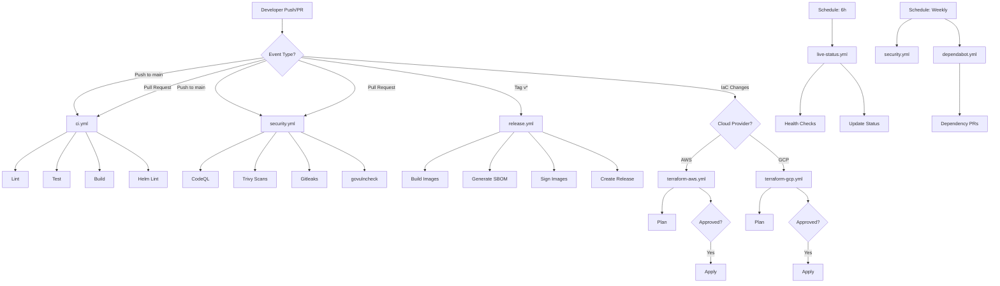

# GitHub Actions Workflows - Visual Overview

## Workflow Architecture

```
┌─────────────────────────────────────────────────────────────────┐
│                        REFERENCE PLATFORM                        │
│                      GitHub Actions CI/CD                        │
└─────────────────────────────────────────────────────────────────┘

┌───────────────────── CONTINUOUS INTEGRATION ─────────────────────┐
│                                                                   │
│  Push/PR → main                                                  │
│      │                                                            │
│      ├─► ci.yml ────────────────┐                                │
│      │   ├─ Lint (golangci)     │                                │
│      │   ├─ Test (coverage)     │                                │
│      │   ├─ Build (binary+img)  ├─► Parallel Execution           │
│      │   └─ Helm Lint           │                                │
│      │                          │                                │
│      └─► security.yml ──────────┘                                │
│          ├─ CodeQL (Go)                                          │
│          ├─ Trivy (repo/config/container)                        │
│          ├─ Gitleaks (secrets)                                   │
│          ├─ govulncheck                                          │
│          └─ Dependency Review                                    │
│                                                                   │
└───────────────────────────────────────────────────────────────────┘

┌───────────────── INFRASTRUCTURE AS CODE ─────────────────────────┐
│                                                                   │
│  Push → terraform/aws/**                                         │
│      │                                                            │
│      └─► terraform-aws.yml                                       │
│          ├─ Matrix: [dev, staging, prod]                         │
│          ├─ OIDC Auth (no credentials)                           │
│          ├─ Plan (PR comments)                                   │
│          ├─ Apply (main only + approval)                         │
│          └─ Security Scan (tfsec, checkov)                       │
│                                                                   │
│  Push → terraform/gcp/**                                         │
│      │                                                            │
│      └─► terraform-gcp.yml                                       │
│          ├─ Matrix: [dev, staging, prod]                         │
│          ├─ Workload Identity (no keys)                          │
│          ├─ Plan (PR comments)                                   │
│          ├─ Apply (main only + approval)                         │
│          └─ Security Scan (tfsec, checkov)                       │
│                                                                   │
└───────────────────────────────────────────────────────────────────┘

┌──────────────────── RELEASE PIPELINE ────────────────────────────┐
│                                                                   │
│  Tag Push: v*                                                    │
│      │                                                            │
│      └─► release.yml                                             │
│          │                                                        │
│          ├─► Build & Push ──────────┐                            │
│          │   ├─ Multi-arch images   │                            │
│          │   │  (amd64, arm64)       │                            │
│          │   ├─ Push to ghcr.io     │                            │
│          │   └─ Generate SBOM       │                            │
│          │                           │                            │
│          ├─► Sign Image ─────────────┤                            │
│          │   ├─ Cosign (keyless)    ├─► Parallel Jobs            │
│          │   └─ Attestation         │                            │
│          │                           │                            │
│          ├─► Security Scan ──────────┤                            │
│          │   └─ Trivy               │                            │
│          │                           │                            │
│          └─► Create Release ─────────┘                            │
│              ├─ Build binaries (multi-platform)                  │
│              ├─ Generate checksums                               │
│              ├─ Create GitHub Release                            │
│              └─ Update deployment manifests (PR)                 │
│                                                                   │
└───────────────────────────────────────────────────────────────────┘

┌────────────────── MONITORING & MAINTENANCE ──────────────────────┐
│                                                                   │
│  Schedule: Every 6 hours                                         │
│      │                                                            │
│      └─► live-status.yml                                         │
│          ├─ Curl health endpoints                                │
│          ├─ Update LIVE_STATUS.md                                │
│          ├─ Commit & push changes                                │
│          ├─ Create/update issues (on failure)                    │
│          └─ Slack notifications (optional)                       │
│                                                                   │
│  Schedule: Weekly (Monday)                                       │
│      │                                                            │
│      └─► security.yml (full scan)                                │
│          └─ All security jobs                                    │
│                                                                   │
│  Schedule: Weekly (Various)                                      │
│      │                                                            │
│      └─► dependabot.yml                                          │
│          ├─ Monday: Go, Docker, GitHub Actions                   │
│          ├─ Tuesday: Terraform (AWS, GCP)                        │
│          └─ Wednesday: Helm charts                               │
│                                                                   │
└───────────────────────────────────────────────────────────────────┘


## Event Flow Diagram



## Job Dependencies

### ci.yml
```
Lint ──┐
Test ──┼──> Build
       │
       └──> Helm Lint (parallel)
```

### security.yml
```
All jobs run in parallel (no dependencies)
├─ CodeQL
├─ Trivy Repo
├─ Trivy Config
├─ Trivy Container (main only)
├─ Gitleaks
├─ govulncheck
└─ Dependency Review (PR only)
```

### terraform-aws.yml / terraform-gcp.yml
```
Terraform ──┐
            ├──> (All parallel)
TFSec ──────┤
            │
Checkov ────┘
```

### release.yml
```
Build & Push ──┬──> Generate SBOM
               ├──> Sign Image
               ├──> Scan Image
               └──> Wait for all ──> Create Release ──> Update Deployment
```

### live-status.yml
```
Check Status ──┬──> Commit Changes
               └──> Notify Slack (on failure)
```

## Security Model

```
┌─────────────────────────────────────────────────────────────┐
│                    SECURITY LAYERS                          │
├─────────────────────────────────────────────────────────────┤
│                                                             │
│  Layer 1: Authentication                                    │
│  ├─ OIDC (AWS, GCP) - No static credentials                │
│  ├─ GitHub Token (automatic, scoped)                       │
│  └─ Workload Identity Federation                           │
│                                                             │
│  Layer 2: Authorization                                     │
│  ├─ Minimal permissions per job                            │
│  ├─ Environment protection rules                           │
│  └─ CODEOWNERS review requirements                         │
│                                                             │
│  Layer 3: Code Analysis                                     │
│  ├─ CodeQL (SAST)                                          │
│  ├─ Dependency scanning                                    │
│  ├─ Secret detection (Gitleaks)                            │
│  └─ License compliance                                     │
│                                                             │
│  Layer 4: Infrastructure Scanning                          │
│  ├─ Trivy (vulnerabilities)                                │
│  ├─ TFSec (Terraform security)                             │
│  └─ Checkov (IaC best practices)                           │
│                                                             │
│  Layer 5: Supply Chain Security                            │
│  ├─ SBOM generation (Syft)                                 │
│  ├─ Image signing (Cosign)                                 │
│  ├─ Artifact attestation                                   │
│  └─ Provenance tracking                                    │
│                                                             │
│  Layer 6: Runtime Monitoring                               │
│  ├─ Health checks (live-status.yml)                        │
│  ├─ Automated alerting                                     │
│  └─ Issue tracking                                         │
│                                                             │
└─────────────────────────────────────────────────────────────┘
```

## Performance Optimization

```
┌─────────────────────────────────────────────────────────────┐
│                PERFORMANCE STRATEGIES                        │
├─────────────────────────────────────────────────────────────┤
│                                                             │
│  ✓ Parallel Job Execution                                  │
│    └─ Jobs run concurrently when no dependencies           │
│                                                             │
│  ✓ Build Caching                                           │
│    ├─ Go module cache (actions/setup-go)                   │
│    ├─ Docker layer cache (type=gha)                        │
│    └─ Terraform plugin cache                               │
│                                                             │
│  ✓ Matrix Builds                                           │
│    └─ Terraform environments in parallel                   │
│                                                             │
│  ✓ Conditional Execution                                   │
│    ├─ Path filters (terraform/**)                          │
│    ├─ Branch restrictions                                  │
│    └─ Event-specific jobs                                  │
│                                                             │
│  ✓ Concurrency Controls                                    │
│    ├─ Cancel in-progress (CI jobs)                         │
│    └─ Prevent concurrent (Terraform, Release)              │
│                                                             │
└─────────────────────────────────────────────────────────────┘
```

## Typical Execution Times

| Workflow | Average Duration | Notes |
|----------|------------------|-------|
| ci.yml | 3-5 minutes | Parallel jobs, cached builds |
| security.yml | 5-8 minutes | Multiple scanners, PR only |
| security.yml (full) | 10-15 minutes | Weekly, includes container scan |
| terraform-aws.yml | 2-4 minutes | Plan only (PR) |
| terraform-aws.yml | 5-10 minutes | Apply (3 environments) |
| terraform-gcp.yml | 2-4 minutes | Plan only (PR) |
| terraform-gcp.yml | 5-10 minutes | Apply (3 environments) |
| release.yml | 8-12 minutes | Multi-arch, multi-platform |
| live-status.yml | 30-60 seconds | Simple health checks |

## Resource Usage

| Resource | Usage | Optimization |
|----------|-------|--------------|
| GitHub Actions Minutes | ~500-800/month | Free tier: 2000/month |
| GitHub Packages Storage | ~10-50 GB | Image retention policies |
| Artifact Storage | ~1-5 GB | 90-day retention on SBOMs |
| Cache Storage | ~10-20 GB | 10 GB limit, auto-eviction |

## Best Practices Implemented

✅ **Security**
- OIDC authentication
- Minimal permissions
- Secret scanning
- SBOM generation
- Image signing
- Dependency updates

✅ **Performance**
- Parallel execution
- Smart caching
- Conditional runs
- Path filtering
- Concurrency control

✅ **Reliability**
- Error handling
- Retry logic (Terraform)
- Health monitoring
- Automated alerts
- Status tracking

✅ **Maintainability**
- Clear naming
- Comprehensive docs
- Version pinning
- Automated updates
- Conventional commits

✅ **Compliance**
- Audit trails
- Provenance tracking
- License checking
- Security scanning
- Attestation

## Integration Points

```
GitHub Actions
    ├─► GitHub Container Registry (ghcr.io)
    ├─► GitHub Security (SARIF uploads)
    ├─► GitHub Releases (artifacts)
    ├─► GitHub Issues (automated creation)
    ├─► AWS (via OIDC)
    ├─► GCP (via Workload Identity)
    ├─► Codecov (coverage reports)
    ├─► Slack (notifications)
    └─► Sigstore (image signing)
```
